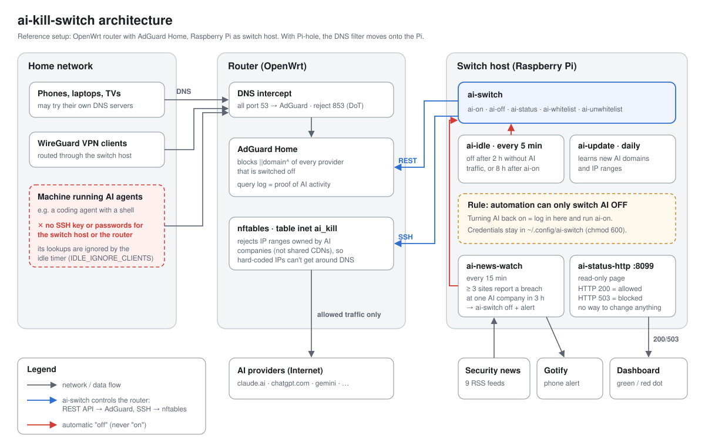
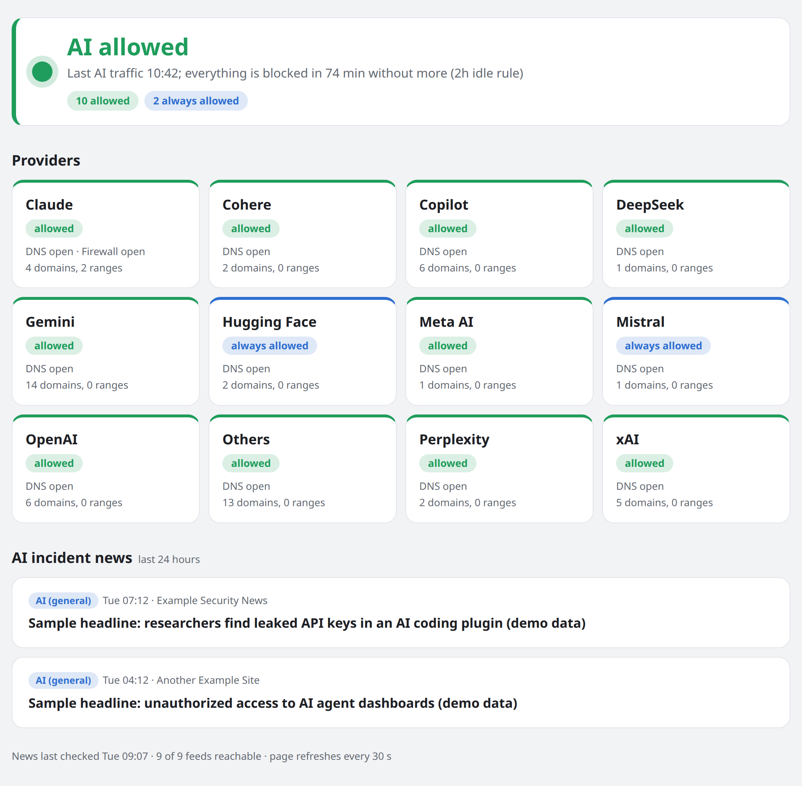

# ai-kill-switch

A network-wide kill switch for AI platforms on a home network. It blocks Claude, ChatGPT,
Gemini, Copilot, DeepSeek and others at the DNS filter and the router firewall, and it
**switches itself off**:

- after 2 hours without real AI traffic on the network,
- 8 hours after the last `ai-on`, whatever the traffic,
- when 3 or more security news sites report a breach at the same AI company within 3 hours.

Turning AI back on is always a manual step on the switch host. The design assumes an AI agent
may be running somewhere on the network and makes sure it can't undo the switch. See
[docs/ARCHITECTURE.md](docs/ARCHITECTURE.md) for the design, the threat model, and how to run
it with **Pi-hole** instead of AdGuard Home.



The read-only status page (`ai-status-http`, port 8099), shown here with demo data:



## Reference setup

- OpenWrt router running AdGuard Home (DNS on :53, UI on :8080)
- A Raspberry Pi (or any small Linux box) that runs the switch
- Optional: Gotify for phone alerts, Homarr (or any dashboard) for a status dot

## Commands (run on the switch host, as the switch user, without sudo)

```
ai-status                  show what is on/off per provider
ai-on  [provider]          allow AI (all, or one provider)
ai-off [provider]          block AI (all, or one provider)
ai-whitelist <provider>    always allow (never blocked, ignored by the idle rule)
ai-unwhitelist <provider>  remove from always-allowed
ai-update                  refresh domain lists and IP ranges (cron, daily)
ai-idle                    idle check (cron, every 5 min)
```

Providers: claude cohere copilot deepseek gemini huggingface metaai mistral openai others perplexity xai.
Add your own by creating `~/.config/ai-switch/providers/<name>/domains`.

## Files

| Path | What |
|---|---|
| `bin/ai-switch` | The switch. One script; the symlink name you call it by picks the command. |
| `bin/ai-news-watch` | Breach watcher for security RSS feeds, blocks AI and sends a Gotify alert. |
| `bin/ai-status-http` | Read-only status page on :8099. HTTP 200 = AI allowed, 503 = blocked. |
| `etc/` | cron, systemd, logrotate and login-banner files. |
| `examples/` | Example config files for `~/.config/ai-switch/config` and `~/.config/ai-news-watch/config`. |
| `docs/INSTALL.md` | Step-by-step install. |
| `docs/ARCHITECTURE.md` | Design, threat model, Pi-hole variant. |

## Limits

- DNS blocking only works if every device has to use your filter: the router must redirect
  port 53 to it and reject port 853.
- Blocking is per domain, not per device. Whitelisting a provider opens it for the whole network.
- The firewall only blocks IP ranges owned by AI companies, not shared CDN ranges.
- Provider domain lists go stale. `ai-update` learns new ones from your query log and lists
  doubtful ones for review, but check `ai-status` now and then.

## License

MIT
