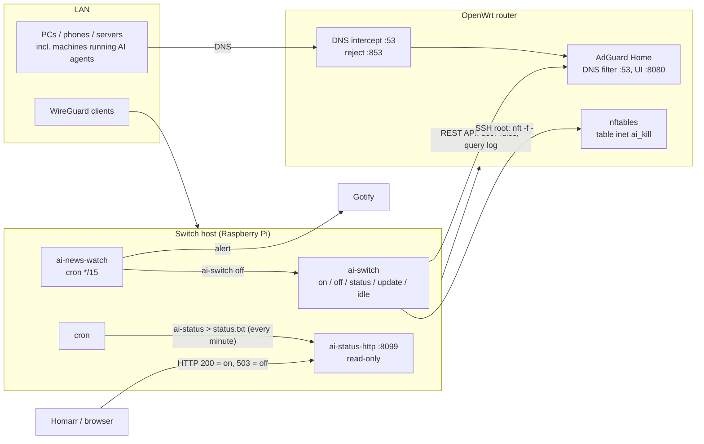

# Architecture

## Goal and threat model

The kill switch blocks AI platforms (Claude, ChatGPT, Gemini, Copilot, …) for a whole home
network, and turns itself on automatically:

- after **2 hours without AI traffic** (`ai-idle`),
- **8 hours after the last `ai-on`**, whatever the traffic (hard cap),
- when **3 or more security news sites** report a breach at the same AI company within 3 hours
  (`ai-news-watch`).

Turning AI back **on** is deliberately manual: you log in to the switch host and run `ai-on`.

The design assumes that an AI agent (for example a coding agent with shell access) may run on
one of the machines in the network, and that it must not be able to undo the switch. So:

1. **The switch runs on a separate host** (a Raspberry Pi in the reference setup). The machines
   that run AI agents have no SSH key, password or API token for that host, the router or the
   DNS filter.
2. **Nothing on the network can turn AI on.** The status page is read-only; there is no
   web button, no Home Assistant toggle, no webhook.
3. **Automation only ever blocks.** `ai-idle` and `ai-news-watch` can call `off`, never `on`.
4. **DNS cannot be bypassed.** The router redirects every plain DNS query (port 53) to the
   filter and rejects DNS-over-TLS (port 853). Known DNS-over-HTTPS resolvers are in the
   block lists.
5. **IP ranges are firewalled too**, so hard-coded IP addresses don't get around DNS blocking.

## Reference setup (OpenWrt + AdGuard Home)



### Components

| File | Runs as | Schedule | Does |
|---|---|---|---|
| `bin/ai-switch` | switch user | on demand | Block or unblock providers. One script, called through symlinks: `ai-on`, `ai-off`, `ai-status`, `ai-update`, `ai-idle`, `ai-whitelist`, `ai-unwhitelist`. |
| `ai-update` | switch user | daily 04:15 | Refreshes published IP ranges, learns new domains from the DNS query log, tracks route changes, lists suspicious domains for review. |
| `ai-idle` | switch user | every 5 min | Blocks everything when no real AI traffic was seen for `IDLE_HOURS`, or `MAX_ON_HOURS` after the last `ai-on`. |
| `bin/ai-news-watch` | switch user | every 15 min | Reads 9 security RSS feeds and blocks AI when enough of them report a breach at one company. Sends a Gotify alert. |
| `bin/ai-status-http` | systemd `DynamicUser` | always | Read-only page on :8099. Reads only `/var/lib/ai-switch-status/`. |
| `etc/ai-switch.logrotate` | root | weekly | Keeps logs small. |

### State on disk (`~/.config/ai-switch/`)

```
providers/<name>/domains   one domain per line (subdomains included); lines starting with / | @ are raw filter rules
providers/<name>/ranges    IP ranges that the router firewall rejects
providers/<name>/hosts     hostnames whose DNS/route changes are tracked daily
state.json                 {"claude": "off", "openai": "on", ...}
whitelist                  providers that are never blocked ("always")
idle.json                  last_ai, on_since, last_check
applied                    the filter rules this tool added (so it never touches your own rules)
suggestions, report.txt, routes.json, changes.log
<filter credentials file>  chmod 600
```

The files are the source of truth. `apply()` makes the DNS filter and the firewall match
`state.json`, so it is safe to run repeatedly and it repairs things after a router reboot.

### How blocking works

1. **DNS:** for every provider that is off, each domain becomes the rule `||domain^$important`
   in AdGuard's user rules. The tool only adds and removes its own rules (tracked in `applied`).
2. **Firewall:** one nftables table on the router, rebuilt atomically each time:
   `table inet ai_kill { chain ai_block { type filter hook forward priority -5; ip daddr <range> reject } }`.
   Only ranges **owned by the AI company** are listed, never shared CDN ranges, so other sites keep working.
3. **Idle detection:** `ai-idle` scans the DNS query log for lookups of blocked-list domains.
   Lookups are ignored when they come from `IDLE_IGNORE_CLIENTS` (the machine that runs AI agents,
   so an agent left running can't keep AI on) or match `IDLE_IGNORE_DOMAINS` (telemetry and update
   checks). Whitelisted providers are ignored too.

### Pitfalls found in practice

- **VPN clients** routed through the switch host appear in the query log with that host's address.
- **Android "Private DNS"** set to a hostname stops working once port 853 is rejected. Set it to *Automatic*.
- **nftables chain names** must not be keywords (`fwd` fails; use `ai_block`).
- **Free Cert Spotter quota** is small; the updater stops when it is used up and continues on the next run.
- **Model downloads** (for example Immich machine learning fetching from Hugging Face) are AI traffic.
  Either whitelist the provider or run the app with `HF_HUB_OFFLINE=1`.

---

## Running it on Pi-hole

Pi-hole fits this design well: it usually **runs on the Pi itself**, so the switch and the DNS
filter live on the same host and no DNS-filter credentials have to cross the network.

```mermaid
flowchart LR
  subgraph LAN
    PC[Clients]
  end
  subgraph Router["Router (OpenWrt or other)"]
    FWD[DNS intercept :53 -> Pi-hole<br/>reject :853]
    NFT[firewall: AI IP ranges]
  end
  subgraph Pi["Raspberry Pi"]
    PH[Pi-hole FTL<br/>DNS :53, API /api]
    SW[ai-switch]
    NW[ai-news-watch]
    ST[ai-status-http :8099]
  end
  PC -- DNS --> FWD --> PH
  SW -- "local API (127.0.0.1)<br/>deny regex + query log" --> PH
  SW -- "SSH: nft -f -  (optional)" --> NFT
  NW --> SW
  ST -. reads status.txt .-> SW
```

### What changes

Only the DNS-filter backend changes. Everything else (provider lists, `state.json`,
idle logic, news watch, status page, cron) stays the same.

| ai-switch needs | AdGuard Home (reference) | Pi-hole v6 (API) | Pi-hole v5 (CLI) |
|---|---|---|---|
| Authenticate | HTTP Basic, `agh-auth` file | `POST /api/auth {"password": …}` returns `sid`; send header `X-FTL-SID`. Use an **app password** (Settings → Web interface/API). | none; run as a user allowed to call `pihole` (sudoers line) |
| Block a domain + subdomains | user rule `\|\|claude.ai^$important` | `POST /api/domains/deny/regex` with `{"domain": "(\\.\|^)claude\\.ai$", "comment": "ai-switch:claude", "groups": [0]}` | `pihole --regex '(\.\|^)claude\.ai$' --comment ai-switch:claude` |
| Unblock | rewrite user rules without ours | `DELETE /api/domains/deny/regex/<url-encoded regex>` | `pihole --regex -d '<regex>'` |
| List current blocks | `GET /control/filtering/status` → `user_rules` | `GET /api/domains/deny/regex`, filter on comment prefix `ai-switch:` | `pihole --regex -l` |
| Query log | `GET /control/querylog?limit=1000&older_than=…` | `GET /api/queries?from=<epoch>&until=<epoch>&length=…` → `queries[].domain`, `.client.ip`, `.time` | `sqlite3 /etc/pihole/pihole-FTL.db "SELECT timestamp,domain,client FROM queries WHERE timestamp > ?"` |
| Apply changes | immediate | immediate | immediate (v5.x reloads lists itself) |

Notes:

- **Use regex deny entries, not exact ones.** AdGuard's `||domain^` matches the domain and every
  subdomain; the Pi-hole equivalent is the regex `(\.|^)domain\.tld$`. Escape the dots.
- **Mark your entries.** Put `ai-switch:<provider>` in the comment field. That replaces the
  `applied` file: the tool only ever deletes entries with that comment, so your own Pi-hole
  lists are never touched.
- **Raw AdGuard rules** (lines starting with `/`, `|` or `@` in a `domains` file) have no direct
  equivalent. Convert `/regex/` lines to Pi-hole regex entries and drop or rewrite the others.
- **Query log fields:** AdGuard returns `question.name`, `client` and `answer[].value`. Pi-hole v6
  returns `domain`, `client.ip` and `reply`. The `ai-update` step that learns new domains from
  their resolved IP addresses needs the answer IPs. Pi-hole's query log doesn't always include
  them, so fall back to a fresh lookup (`doh()` already exists in the script).
- **Blocking mode:** Pi-hole's default (`NULL`, answering `0.0.0.0`) works. Apps fail fast instead of timing out.

### Suggested code shape

Keep `apply()`, `status()`, `update()` and `idle()` as they are and move the three
backend calls behind a small interface, picked with `FILTER = "adguard" | "pihole"` in the config:

```python
class PiHole:
    """Pi-hole v6 backend. Runs on the same host, so the API is reached on 127.0.0.1."""
    TAG = "ai-switch:"

    def __init__(self, url="http://127.0.0.1", password_file=CONF / "pihole-app-password"):
        self.url = url
        r = self._call("POST", "/api/auth", {"password": password_file.read_text().strip()}, auth=False)
        self.sid = r["session"]["sid"]

    def _call(self, method, path, body=None, auth=True):
        req = urllib.request.Request(self.url + path, method=method,
                                     data=None if body is None else json.dumps(body).encode(),
                                     headers={"Content-Type": "application/json",
                                              **({"X-FTL-SID": self.sid} if auth else {})})
        with urllib.request.urlopen(req, timeout=30) as r:
            data = r.read()
        return json.loads(data) if data else {}

    @staticmethod
    def regex(domain):
        return r"(\.|^)" + re.escape(domain) + "$"

    def our_rules(self):
        return {d["domain"]: d["comment"] for d in self._call("GET", "/api/domains/deny/regex")["domains"]
                if (d.get("comment") or "").startswith(self.TAG)}

    def set_blocked(self, wanted):  # wanted: {domain: provider}
        want = {self.regex(d): self.TAG + p for d, p in wanted.items()}
        have = self.our_rules()
        for rx in have.keys() - want.keys():
            self._call("DELETE", "/api/domains/deny/regex/" + urllib.parse.quote(rx, safe=""))
        for rx in want.keys() - have.keys():
            self._call("POST", "/api/domains/deny/regex", {"domain": rx, "comment": want[rx], "groups": [0]})

    def query_log(self, since):
        q = self._call("GET", f"/api/queries?from={int(since.timestamp())}&length=100000")["queries"]
        # Same shape as the AdGuard entries the rest of the script reads
        return [{"time": datetime.fromtimestamp(e["time"], timezone.utc).isoformat(),
                 "question": {"name": e["domain"]}, "client": e["client"]["ip"], "answer": []} for e in q]
```

This is a design sketch, not tested code. Check the endpoint names against your Pi-hole's own
API docs at `http://<pi-hole>/api/docs` before using it.

### Router requirements with Pi-hole

Pi-hole only sees DNS that is sent to it, so the router still has to enforce that:

| Requirement | OpenWrt | Other routers |
|---|---|---|
| Clients use Pi-hole for DNS | DHCP option 6 → Pi-hole IP | DHCP DNS setting, or let Pi-hole run DHCP |
| Hard-coded DNS (8.8.8.8 …) is caught | firewall redirect: LAN port 53 → Pi-hole, **excluding the Pi-hole's own address** (or it loops) | often not possible; block outbound :53 for everything except the Pi-hole if the router allows it |
| DNS-over-TLS blocked | reject LAN → WAN port 853 | block outbound :853 |
| DNS-over-HTTPS blocked | DoH resolver domains are in the `others` provider; Pi-hole blocks them by name | same |
| IP-range firewall (optional, stronger) | `ai-switch` writes an nftables table over SSH, as in the reference setup | skip it: DNS blocking alone still covers normal apps and browsers |

If the router can't do the redirect, the switch still works for every device that uses
Pi-hole as its resolver, but a program with its own hard-coded resolver can get past it.

### Keep the security properties

- The Pi-hole **app password** lives only on the Pi (`chmod 600`). Don't put it in a password
  manager that an AI agent can read, and don't give agent machines access to the Pi-hole web UI.
- Don't expose the Pi-hole API to the LAN if you don't use the web UI from other machines.
  Bind it to localhost (`webserver.port = "127.0.0.1:80"` in `pihole.toml`) and use an SSH tunnel when you need the UI.
- Add the machines that run AI agents to `IDLE_IGNORE_CLIENTS`, as in the reference setup.
